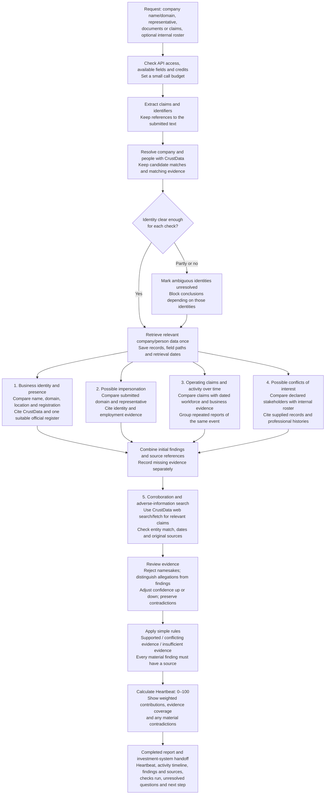

# Company trust investigation pipeline with Heartbeat

**Implementation:** The Python library and CLI are available; see the [integration guide](README.md), [agreed implementation contract](IMPLEMENTATION.md), and [observed verification](VERIFICATION.md). No website or HTTP server is required.

**Data preflight:** See [CrustData readiness and observed gaps](heartbeat-data-readiness.md), checked 31 October 2026. Core identity/enrichment access works; use `/web/enrich/live` for fetches. Recent activity coverage varies, person verification/live refresh are disabled, and registration plus internal disclosures still require separate evidence. Build partial-result handling into the first slice.

Combine checks 1–4 in one investigation. Each check collects and cites its own evidence. Check 5 then searches for corroborating or conflicting information and revises the findings where justified.

**Heartbeat** combines these results into a transparent 0–100 confidence score. Evidence of operations over time is one factor, alongside identity, representative consistency, and relationship disclosures. Show evidence coverage and material contradictions beside the score. Keep investment attractiveness separate.

## What each check can conclude

| Check | Useful result | Evidence gap to preserve |
|---|---|---|
| **1. Vendor legitimacy** | Submitted business details agree with, or conflict with, the resolved business and its observed activity | Legal existence requires authoritative registration evidence; provider status alone is insufficient |
| **2. Impersonation** | Submitted identifiers or representative details are inconsistent with the claimed business | Employment does not establish control of an email account or signing authority; alternate domains may be legitimate |
| **3. Shell-company risk triage** | Specific operating claims have support, conflicting evidence, or insufficient evidence | Sparse public data does not establish a shell company; ownership and transaction evidence may be unavailable |
| **4. Conflicts of interest** | A dated professional overlap or declared relationship needs disclosure review | Without an authorized internal roster, mark this check insufficient evidence; professional overlap alone does not prove a conflict |

## Keep the implementation small

### Heartbeat calculation

Start with these editable hackathon weights, fixed before a run:

| Component | Weight | What contributes |
|---|---|---|
| Business identity | 35% | Agreement between submitted details, the resolved company, and official registration evidence where accessible |
| Company and representative consistency | 25% | Agreement between claimed domains, people, roles, and sourced professional information |
| Operating claims and activity | 30% | Supported operating claims and relevant activity across time, with recent evidence and different activity types |
| Relationship disclosures | 10% | Whether supplied disclosures agree with checked affiliations; a professional overlap alone is not a negative finding |

Within each component, list the checks before research. Give supported checks **100**; confirmed contradictions and unresolved checks score **0**, so points are earned only with supporting evidence. Contradictions stay distinguishable through the finding labels and outcome rules. Use the average as the component score, then calculate **Heartbeat = 0.35 × identity + 0.25 × consistency + 0.30 × operations + 0.10 × disclosures**. Use ordinary code for the arithmetic; the model explains the evidence.

**Coverage** is the same weighted calculation using the fraction of checks with usable evidence in each component. Checks that cannot apply to the request are **not applicable** and excluded: representative authority when no representative is submitted, and disclosures when no roster or disclosures are supplied. Applicable components keep their relative weights. Missing evidence for an applicable check still scores 0; it is never dropped. Example: all checks unresolved gives **Heartbeat 0/100, coverage 0% — insufficient evidence**. Initially label coverage below 60% as provisional; unresolved company identity always makes the overall result insufficient evidence. These are explainable demo rules, not calibrated probabilities.

Check 5 updates the evidence and statuses of the existing checks; it does not add a separate bonus for finding more articles. Count the same underlying fact once across components. Keep material contradictions visible regardless of the total: a confirmed mismatch between the claimed and resolved company puts the case on hold even if other components score well.

### Activity timeline

Use the past **12 months**, shortened for younger companies. Plot the count of distinct sourced activity observations per month, with each point opening its evidence. Examples include product releases, dated customer work, job postings, and observed workforce changes. Label these as observed public activity, not a complete measure of work performed. Hiring plans and profile changes are indirect signals; primary evidence of delivered work is stronger.

Ten articles about one launch count as one event. A headcount series is a trend, not a new work event per employee per month. Undated evidence stays outside the timeline. Missing months remain unknown unless the source actually establishes no activity. Do not reward a particular waveform, or assume peaks and troughs prove legitimacy.

The operations component uses a short checklist: supported operating claims, recent activity, activity across the available period, and different kinds of activity. Record the evidence and time window behind each status. A lack of visible activity leaves a check unresolved unless it contradicts a specific claim.

### Final result

Deliver Heartbeat, coverage, the activity timeline, all component contributions, and the source-linked findings together. Use **continue with diligence** when identity is resolved, coverage is sufficient, and no material issue needs verification; **hold for a specific verification** for a material contradiction or supported concern; otherwise **insufficient evidence**. The numeric score does not override these rules or establish shell-company status.

Pass company/person IDs and claim/evidence IDs to the investment system, identifying which investment assumptions are supported, conflicting, or unknown. Include a short history of completed, skipped, and failed checks. Select one accessible official register for the target jurisdiction; if unavailable or ambiguous, mark registration unresolved.

Use one backend workflow with four check functions sharing the same retrieved records and source list. The branches show separate checks; they do not require separate agents. Use model calls to extract claims and summarize evidence, with ordinary code controlling identity thresholds, missing-data handling and final labels.

Every finding stores: **claim, result, evidence IDs, confidence reason and missing evidence**. Every evidence record stores: **URL or CrustData record ID, field path or excerpt, source date if known, and retrieval time**. Keep raw responses locally. A submission is evidence of what was claimed, not proof that the claim is true.

Check 5 is a bounded follow-up, not an automatic confidence boost. Fetch relevant primary sources where accessible and search for both corroboration and contradictions. No adverse search results do not establish a clean record. Repeated articles citing the same source do not count as independent corroboration. Stop at the request's time/credit budget and report remaining gaps.

Apply the [sample's observed limitations](shark-information-crust-data-provides.md): null hiring is unknown, revenue is estimated, employee ranges and measured headcount have different meanings, news can concern namesakes, and unknown freshness stays unknown. Skip unavailable checks rather than inventing evidence. Return a partial report when calls fail.

The output is an investigation and bounded next-step recommendation. Keep actions local and read-only; do not contact people or perform transactions. This is the requested Heartbeat variant of the original pipeline; it does not edit the separate SignalGate plan. No extra agents or data services are needed solely to calculate the score.
