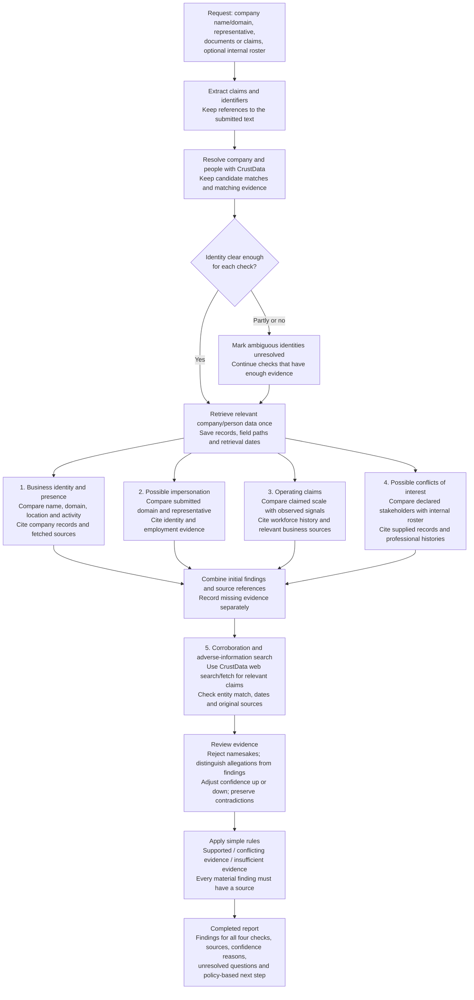

# Vendor trust investigation pipeline

Combine checks 1–4 in one investigation. Each check collects and cites its own evidence. Check 5 then searches for corroborating or conflicting information and revises the findings where justified.

## What each check can conclude

| Check | Useful result | Evidence gap to preserve |
|---|---|---|
| **1. Vendor legitimacy** | Submitted business details agree with, or conflict with, the resolved business and its observed activity | Legal existence requires authoritative registration evidence; provider status alone is insufficient |
| **2. Impersonation** | Submitted identifiers or representative details are inconsistent with the claimed business | Employment does not establish control of an email account or signing authority; alternate domains may be legitimate |
| **3. Shell-company risk triage** | Specific operating claims have support, conflicting evidence, or insufficient evidence | Sparse public data does not establish a shell company; ownership and transaction evidence may be unavailable |
| **4. Conflicts of interest** | A dated professional overlap or declared relationship needs disclosure review | Without an authorized internal roster, mark this check insufficient evidence; professional overlap alone does not prove a conflict |

## Keep the implementation small

Use one backend workflow with four check functions sharing the same retrieved records and source list. The branches show separate checks; they do not require separate agents. Use model calls to extract claims and summarize evidence, with ordinary code controlling identity thresholds, missing-data handling and final labels.

Every finding stores: **claim, result, evidence IDs, confidence reason and missing evidence**. Every evidence record stores: **URL or CrustData record ID, field path or excerpt, source date if known, and retrieval time**. Keep raw responses locally. A submission is evidence of what was claimed, not proof that the claim is true.

Check 5 is a bounded follow-up, not an automatic confidence boost. Fetch relevant primary sources where accessible and search for both corroboration and contradictions. No adverse search results do not establish a clean record. Repeated articles citing the same source do not count as independent corroboration. Stop at the request's time/credit budget and report remaining gaps.

Apply the [sample's observed limitations](shark-information-crust-data-provides.md): null hiring is unknown, revenue is estimated, employee ranges and measured headcount have different meanings, news can concern namesakes, and unknown freshness stays unknown. Skip unavailable checks rather than inventing evidence. Return a partial report when calls fail.

The output is an investigation and bounded next-step recommendation. Keep actions local and read-only; do not contact people or perform transactions. This document describes the requested vendor workflow and does not change the separate SignalGate investment-diligence plan in project steering.
