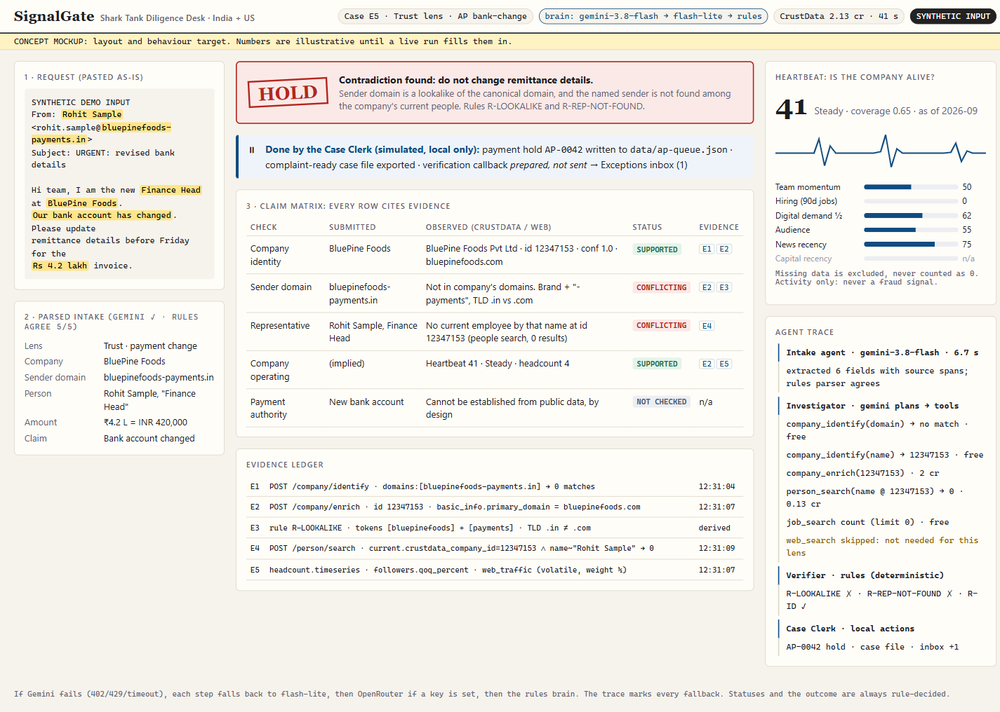

# SignalGate: Shark Tank Diligence Desk (India + US)

**SignalGate is an AI diligence desk.** You paste a deal or vendor request about a startup. Its agents investigate the request through **CrustData's canonical identity graph** and then finish the job:
- an IC memo for an investor
- an auditor-ready vendor file for procurement
- a payment hold with a complaint-ready case file for accounts payable

A human only sees the exceptions.

Built for ContextCon 03 at IIT Bombay (CrustData × YC), in the *Investing* and *Trust & Compliance* themes.



## What it does, end to end

```
messy request ─► INTAKE ─► INVESTIGATOR ──tools──► CrustData: identify · enrich · people · jobs · web search/fetch
(email/pitch/      │            │  evidence ledger: every fact → record id / URL / field path
 form/tip)         │            ▼
                   │       VERIFIER: deterministic rules + Heartbeat → statuses and outcome
                   │            ▼
                   └──────► CASE CLERK ─► memo / vendor file / case file
                                         + local action: deal pipeline · vendor master · AP payment hold
                                         └─► Exceptions inbox (the only human queue)
     brain = Gemini (gemini-3.8-flash → flash-lite) → OpenRouter (optional) → rules   ·   LLM never sets a status
```

| Service | Finished work | Local action (simulated) |
|---|---|---|
| Pre-investment screen (VC) | IC memo, thesis fit, Heartbeat, claim matrix | `data/systems/pipeline.json`: Advance / Hold / Pass |
| Founder verification (angel) | Founder claims with dated employment evidence | Pipeline note |
| Vendor onboarding (procurement) | Vendor file | `vendors.json`: Approved / Exception |
| Bank-change / BEC check (accounts payable) | Complaint-ready case file | `ap-queue.json` **payment hold**, plus a prepared (unsent) callback |
| Adverse-information check (compliance) | Labelled dossier | Inbox entry |

## Verified demo cases (live CrustData, 31 Oct 2026)

| Case | Input | Outcome | What the agents caught |
|---|---|---|---|
| **E5** India, synthetic BEC | Email from `rohit.sample@bluepinefoods-payments.in` asking to change bank details | **HOLD** → payment hold | Lookalike domain (brand + "-payments", `.in` vs `.com`). "Rohit Sample" was never at BluePine Foods (id 12347153). |
| **E3** India pitch | Forwarded email calling the company "BluePine Industries" | **HOLD** | Name recovered by domain. Co-founder Naveen Panwar **left in 2023-10**. Measured headcount is 4, not ~20. The ₹75L Shark Tank deal is in the press but **missing from the funding record**. |
| **E8** US follow-on | "VerbalizeIt has 45 people and spends $27K/mo on ads" | **PASS** | **Acquired by Smartling on 2016-05-19** while the record says "active". The ad spend belongs to the acquirer's domain and is excluded from Heartbeat. |
| **E6** name only | "supplier 'Zeta' wants net-60" | **INSUFFICIENT** | 25 candidates, so no conclusions are drawn |

E1, E2, E4 and E7 are also in [EXAMPLES.md](EXAMPLES.md).

## Run it

```bash
cd Trust-compliance-shresth/app
npm install
# app/.env.local (never commit):
#   CRUSTDATA_API_KEY=...            required
#   LLM_PROVIDER=gemini              optional: none | gemini | openrouter
#   LLM_MODEL=gemini-3.8-flash
#   LLM_FALLBACK_MODELS=gemini-flash-lite-latest
#   GEMINI_API_KEY=...               optional
#   OPENROUTER_API_KEY=...           optional
npm run dev                # http://localhost:3000  (UI with streamed agent trace)
npm run case -- E5         # CLI: run an example end to end
npm run case -- "free text request"
```

## Credits and rationing

CrustData credits are shared with the team, so every paid call is rationed before it goes out.

**Limits** (all set in `lib/config.ts` and overridable by env):

| Limit | Default |
|---|---|
| App total | 1,500 credits (`data/ledger.json`) |
| Per run | 25 credits |
| Per-endpoint calls per run | 2 enrich, 3 person search, 2 person enrich, 3 web search, 2 web fetch |
| LLM | 6 calls per run, 30k tokens per run, 400 calls in total |

**How it's enforced:**
- **The exact charge** comes from CrustData's `x-credits-used` response header.
- **Cache:** identical requests are served from `data/cache/` at 0 credits for 24 hours. Re-running a demo case is free.
- **Free calls first:** `company/identify`, `job/search` (`limit:0` aggregation) and `/account/*` are free, and searches that return zero results cost 0.
- **Over-cap steps** are skipped and shown as "rationed" in the trace. The case still completes with "not checked" findings.
- **Observed cost:** about 0–3 credits per case (E5 ≈ 2, E3 ≈ 1.2, E8 ≈ 3, E6 = 0).

## Heartbeat (activity, not legitimacy)

`Heartbeat = round(Σ wᵢ·sᵢ / Σ wᵢ)`, taken only over components that have data. Coverage is `Σ wᵢ(available) / 100`.

| Component | Weight | Source |
|---|---|---|
| Team momentum | 25 | `headcount.growth_percent` |
| Hiring | 20 | Distinct roles in 90 days (`job/search`) |
| Digital demand | 20 | `web_traffic` QoQ. Halved if volatile; excluded if acquired. |
| Audience | 10 | `followers` QoQ |
| News recency | 15 | Relevant news only |
| Capital recency | 10 | `funding` |

- **Bands:** Strong pulse, Steady, Faint or Flatline signals. "Low signal" is shown when coverage is below 0.5.
- Heartbeat feeds the thesis fit and may raise a "review" on growth claims.
- **It never causes a Hold by itself.**

## Rules (the Verifier)

| Rule | What it does |
|---|---|
| R-DOMAIN-FIRST | A domain match beats a name match |
| R-NAME-RECOVERY | Tries name variants and the domain when the input name is wrong |
| R-AMBIGUOUS | Close candidates mean no company-specific conclusions |
| R-ACQUIRED | An acquired company returns "not independent"; signals that may belong to the acquirer are excluded |
| R-STATUS-CONFLICT | Flags provider fields that contradict each other |
| R-DEPARTED | A person claimed as current, but whose role has an end date |
| R-REP-NOT-FOUND | The person asking for a payment change isn't at the company |
| R-LOOKALIKE | Brand plus extra token, TLD swap, hyphenation, edit distance or homoglyphs |
| R-FUNDING-GAP | A deal reported on the web but missing from the funding record is marked "conflicting sources" |
| R-OTHER-EVENT | Namesakes and different events are rejected (LLM judge, with a rules fallback) |
| R-SELF-DESC | The company's own description counts as self-reported support only |
| R-VOLATILE | Traffic that swings more than 3× has its weight halved |
| R-LOCATION | Region-aware (for example, Faridabad counts as Delhi NCR) |
| POLICY-BANK-CHANGE | Payment authority is never inferred from public data |

## Boundaries

- Read-only research through CrustData. Every "action" is a local JSON write, labelled simulated.
- It never emails, calls or pays anyone.
- It never claims fraud, KYC/AML clearance, beneficial ownership or creditworthiness.
- Missing data shows up as "insufficient" or "not checked", never as guilt.
- Synthetic demo inputs use fictitious people and lookalike domains.

## Files

- `app/lib/engine.ts`: orchestrator, Verifier rules, outcomes, Clerk
- `app/lib/crustdata.ts`: API client with rationing, cache, retries and pacing
- `app/lib/budget.ts`: ledger and caps
- `app/lib/intake.ts`: rules parser plus span-checked LLM extraction
- `app/lib/llm.ts`: Gemini / OpenRouter chain with fallbacks
- `app/lib/heartbeat.ts`, `app/lib/domain.ts`, `app/lib/actions.ts`
- `app/app/page.tsx` and `app/app/api/*`: UI and streaming API
- [PLAN.md](PLAN.md), [EXAMPLES.md](EXAMPLES.md), [concept/](concept/)

The CrustData request pattern is adapted from [crustdata/tools](https://github.com/crustdata/tools) (MIT).
